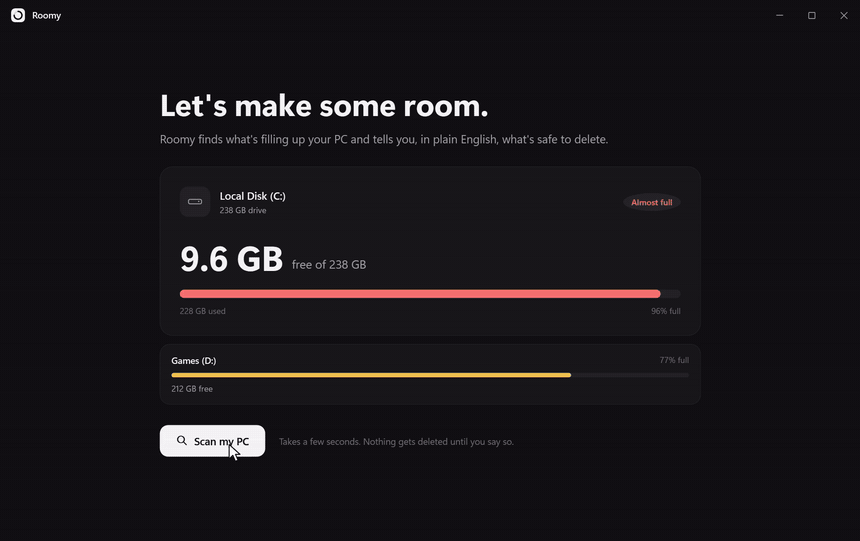
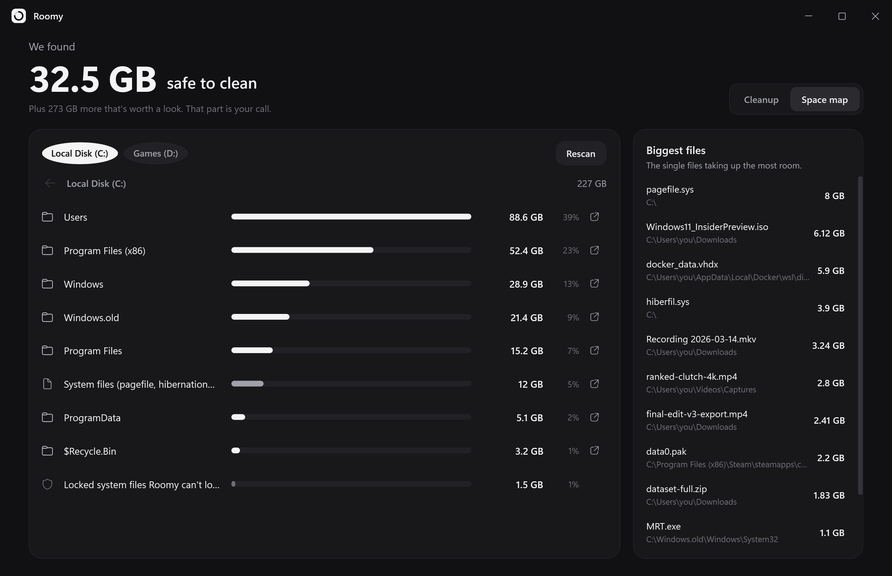
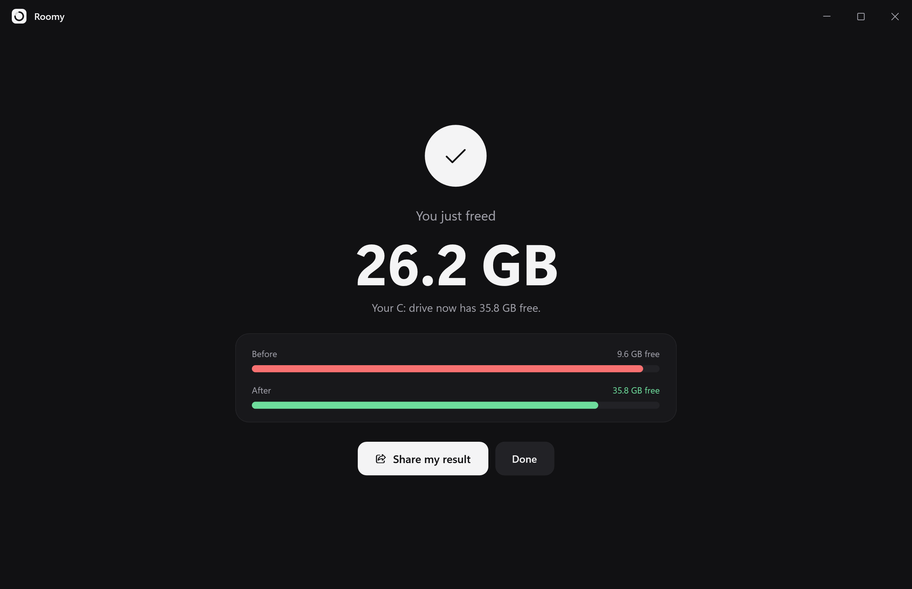

<p align="center">
  
</p>

<h1 align="center">Roomy</h1>

<p align="center">
  <b>Your C: drive is full. Let's fix that.</b><br>
  See what's eating your space in plain English, and clean the safe stuff in one click.
</p>

<p align="center">
  <a href="https://github.com/krezio/roomy/releases/latest"></a>
  <a href="https://github.com/krezio/roomy/stargazers"></a>
  
  
  <a href="https://roomy.krezio.xyz"></a>
</p>

<p align="center">
  <a href="https://roomy.krezio.xyz"></a>
</p>

<p align="center">
  <a href="https://github.com/krezio/roomy/releases/latest/download/Roomy-Setup.exe"><b>⬇ Download for Windows</b></a> &nbsp;·&nbsp;
  <a href="https://roomy.krezio.xyz">Website &amp; live demo</a> &nbsp;·&nbsp;
  <a href="https://roomy.krezio.xyz/guides/">Guides</a>
</p>

> ⭐ **If Roomy freed up space for you, a star helps other people find it.** It takes one click and it genuinely helps.

## Why

Most cleaners stick to temp files and the Recycle Bin, and Windows' own tools miss a lot. Roomy also goes after the space they usually skip (GPU shader caches, app caches, Windows Update leftovers, forgotten Steam games), and it tells you **what** each thing is, **why** it's there and **whether it's safe** before you touch anything. Free, offline, open source.

## What it finds

| | Category | Default |
|---|---|---|
| ♻️ | Windows Update leftovers, Delivery Optimization, Windows temp (needs admin) | ✅ Safe |
| 🧩 | App caches: Discord, VS Code, Slack, Teams, Steam web, npm, pip, Yarn, NuGet | ✅ Safe |
| 🌐 | Browser caches: Chrome, Edge, Brave, Vivaldi, Firefox, Opera | ✅ Safe |
| 🕒 | Temp files (older than a day), crash dumps, error reports, Recycle Bin | ✅ Safe |
| 🎨 | GPU shader caches (NVIDIA, AMD, Intel, DirectX, Steam) | Safe, unticked |
| 📦 | Old installers & big untouched downloads | Your call |
| 🎮 | Steam games you haven't played in 2+ months (uninstalls through Steam) | Your call |
| 🪟 | `Windows.old` (opens Windows' own cleanup) | Your call |

Plus a **Space map** that lets you click down through any drive folder by folder and see the biggest files on your PC.

<p align="center">
  
  
</p>

## Safety

- **Read-only scan.** Nothing is deleted until you click *Clean up*.
- **Your folders are hard-blocked.** Documents, Desktop, Pictures, Videos, Music, Downloads (as a folder), your user folder, Windows and Program Files can never be wiped. See [`FileOps.Guard`](src/Roomy/Core/FileOps.cs).
- **Never follows junctions or symlinks**, so a link can't point the cleaner somewhere unexpected.
- **In-use files are skipped**, never forced.
- **"Your call" items start unticked** and ask for confirmation before permanent deletion.
- **No network access at all.** No telemetry, no accounts, no updates phoning home.

## Install

Grab **Roomy-Setup.exe** (installs per-user, no admin needed) or **Roomy-portable.exe** from [Releases](https://github.com/krezio/roomy/releases/latest). A Microsoft Store version is on the way.

<p align="center">
  <video src="site/assets/video/roomy-demo.mp4" width="860" autoplay muted loop playsinline></video>
</p>

## Microsoft Store build

`packaging/build-msix.ps1` builds `dist/Roomy.msix` for Partner Center (the Store signs it). Pass the identity values from *Product management → Product identity*.

## Build it yourself

Requires the [.NET 10 SDK](https://dotnet.microsoft.com/download).

```bash
dotnet run --project src/Roomy                  # run it
dotnet run --project src/Roomy -- --demo        # fake data, safe for recordings
```

Release build (single self-contained exe):

```bash
dotnet publish src/Roomy -c Release -r win-x64 --self-contained -p:PublishSingleFile=true -p:IncludeNativeLibrariesForSelfExtract=true -p:EnableCompressionInSingleFile=true -o dist
```

Handy flags:

| Flag | What it does |
|---|---|
| `--demo` | Uses made-up data. Nothing on your PC is read or touched. |
| `--shots <dir>` | Runs the demo and saves screenshots of every screen to `<dir>`. |
| `--scan-report <file>` | Runs a real, read-only scan and writes the results to a text file. |
| `--export-icon <file.ico>` | Renders the app icon. |

## Project layout

```
src/Roomy/
  Core/         scanning, cleaning, Steam library reader, safety guards (no UI)
  ViewModels/   state for each screen
  Controls/     animated bar, count-up text, spinner, logo
  MainWindow    the whole UI
installer/      Inno Setup script
site/           roomy.krezio.xyz
```

## Contributing

Know a cache folder Roomy should clean, or found something it gets wrong? [Open an issue](https://github.com/krezio/roomy/issues) or send a pull request. And if Roomy helped you, a ⭐ really does help others find it.

## License

[MIT](LICENSE) © 2026 krezio
